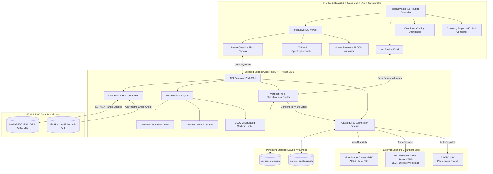

# SPHEREx Blink: PlanetX Discovery Engine & Astronomical Candidate Catalogue
### NASA International Space Apps Challenge 2026

[](https://spherexblink.tech/)
[](https://github.com/Nirbaan13/team_showerless/actions)
[](https://opensource.org/licenses/MIT)
[](https://www.jpl.nasa.gov/missions/spherex)
[](https://doi.org/10.26131/IRSA652)
[](https://www.minorplanetcenter.net/iau/info/ADES.html)

> 🚀 **Live Production Platform**: [https://spherexblink.tech](https://spherexblink.tech/)  
> 🛰️ **Full-Stack VPS Mirror**: [http://146.103.122.246:8080](http://146.103.122.246:8080/)
>
> 🐳 **Docker image for local deploy**: [GitHub Packages (v1)](https://github.com/Nirbaan13/team_showerless/pkgs/container/team-showerless-demo) · [Download v1 archive (1.67 GB)](https://github.com/Nirbaan13/team_showerless/releases/download/demo-v1-main-5301faa3a0ae392b0b4e2c120150849757b8546c/spaceapps-demo-v1.tar.gz)

---

## Executive Summary & System Scope

NASA’s **SPHEREx** (Spectro-Photometer for the History of the Universe, Epoch of Reionization and Ices Explorer) mission surveys the full sky every six months across **102 near-infrared spectral bands ($0.75 - 5.0\ \mu\text{m}$)**. Within these multi-epoch data cubes lie moving solar system objects (asteroids and comets), variable stars, brown dwarfs, stellar flares, and extragalactic transients.

Utilizing this high-cadence spectrophotometric data at scale presents three major operational hurdles:
1. **Bandwidth and Storage Constraints**: Full-sky multi-epoch FITS mosaics span terabytes of raw data, making direct client-side downloads impractical for distributed research and citizen science teams.
2. **Residual Signal Artifacts**: Standard single-band blink comparators cannot systematically isolate genuine trajectories from detector artifacts, cosmic ray hits, optical latents, or passband variations across non-contiguous detector arrays.
3. **Clearinghouse Intake Standards**: Formal clearinghouses, including the **Minor Planet Center (MPC)**, **IAU Transient Name Server (TNS)**, and **AAVSO Variable Star Index (VSX)**, require strict formatting, astrometric accuracy, multi-epoch leave-one-out validation, and peer consensus before admitting candidates to official review.

### System Overview: SPHEREx Blink
**SPHEREx Blink** provides a full-stack discovery, analysis, and cataloguing pipeline engineered to solve these challenges:
* **Targeted Archive Streaming**: Fetches on-demand calibrated cutouts from NASA/IPAC IRSA via TAP/SIA spatial queries without requiring complete mosaic downloads.
* **Leave-One-Out Difference Imaging**: Computes per-frame median reference backgrounds, subtracts zodiacal light models (`ZODI`), and applies pixel quality bitmasks (`FLAGS`).
* **Multi-Method Trajectory Linking**: Implements a linear vector tracker alongside a dedicated **BLOOM centroid recovery engine** tailored specifically for saturated solar system targets.
* **102-Band Spectrophotometry**: Evaluates flux density ($F_\lambda$) curves across all detector arrays with diagnostic absorption template matching (water ice, carbon dioxide ice, silicates, and carbonaceous organics).
* **Community Peer-Review Engine**: Facilitates structured deliberation between citizen volunteers and verified NASA/IAU astronomers.
* **Automated Consensus & Clearinghouse Dispatch**: Enforces a strict 10-confirmation threshold. Once reached, candidates are automatically formatted as **IAU ADES XML/PSV** or **IAU TNS JSON**, dispatched to external clearinghouses, and recorded with real-time acceptance or rejection diagnostics in a persistent SQLite WAL catalogue.

---

## System Architecture & Data Flow



---

## Core Functional Capabilities

### 1. Multi-Epoch Sky Viewer & Blink Comparator
* **Leave-One-Out Difference Imaging**: Generates clean reference baselines by median-combining out-of-epoch frames, rendering moving bodies and flux variations as clear dipolar signals.
* **Dynamic Contrast Scaling**: Supports ZScale interval auto-stretching ($1\text{st}-99\text{th}$ percentile), as well as Linear, Logarithmic, and Asinh transfer functions.
* **Time-Lapse Movie Engine**: Configurable playback rate (1 to 30 FPS), single-frame stepping, looping, and real-time cursor coordinate readout (RA, Dec, pixel index).
* **Automated Coverage Management**: Automatically identifies missing exposures across detector arrays ($1-6$) and provides explanatory skip notices without interrupting playback.
* **Dual Interface Personas**:
  * **Volunteer View**: Simplified layouts, visual trajectory tracks, and accessible diagnostic descriptors.
  * **Research Astrophysicist View**: Unmasked FITS header inspection, raw bitmask overlays (`FLAGS`), RMS astrometric residuals, and photometric error bounds.

### 2. Trajectory Linking & Saturated Source Centroiding
* **Heuristic Residual Tracking**: Filters static stellar profiles, isolates residual peaks ($\ge 3.0\sigma$), and links linear trajectories across three or more visits.
* **Random Forest Reranking**: Evaluates trajectory likelihood using models trained on 80 synthetic infrared injection fields, assessing track length, median residual S/N, and trajectory consistency.
* **BLOOM Centroid Recovery for Saturated Sources**: Bright moving objects saturate SPHEREx detectors, compromising standard centroid fits. The system detects connected `BLOOM` flagged pixel regions ($\ge 6\text{ px}$) and tracks their geometric centroids, enabling accurate recovery of bright bodies such as **Asteroid (4) Vesta**.

### 3. 102-Band Spectrophotometric Profiling
* **Spectral Energy Distribution ($F_\lambda$)**: Extracts calibrated flux density across the complete $0.75 - 5.00\ \mu\text{m}$ SPHEREx spectral range.
* **Molecular Absorption Overlays**:
  * **Water Ice ($H_2O$)**: Characteristic absorption features at $1.5\ \mu\text{m}$, $2.0\ \mu\text{m}$, and $3.05\ \mu\text{m}$.
  * **Carbon Dioxide Ice ($CO_2$)**: Distinct absorption dip at $4.27\ \mu\text{m}$.
  * **Silicates & Carbonaceous Organics**: Evaluates continuum slopes and aliphatic C-H absorption bands ($3.3 - 3.4\ \mu\text{m}$).

### 4. Community Verification Stream & Consensus Engine
* **Role-Differentiated Discussions**: Distinguishes inputs submitted by **NASA / IAU Verified Scientists** from those submitted by **Citizen Volunteers**.
* **Standardized Review Schema**:
  * `confirm_motion`: Confirmed solar system trajectory.
  * `likely_real`: Significant non-moving astrophysical source.
  * `detector_artifact`: Optical latent, cosmic ray, or charge transfer anomaly.
  * `unsure`: Insufficient S/N; requires subsequent data releases.
* **Consensus Gauge**: Real-time visual tracking of progress toward the required 10-confirmation threshold.

### 5. Persistent Astronomical Candidate Catalogue (`planetx_catalogue.db`)
* **Strict Peer-Review Gate**: To protect data integrity, candidates cannot be registered manually in the catalog. Ingestion occurs strictly via discussion threads created in the Verification Feed.
* **Lifecycle State Tracking**:
  * `under_review`: Candidate indexed from community thread ($< 10$ confirmations).
  * `community_verified`: Consensus threshold met ($\ge 10$ confirmations).
  * `submitted_external`: Dispatched to clearinghouse; awaiting review reply.
  * `externally_confirmed` (Accepted): Cleared by clearinghouse; IAU/MPC identifier logged.
  * `rejected`: Did not meet clearinghouse validation standards; diagnostic failure reasons recorded.
* **Multi-Parametric Filtering**: Real-time filtering by status pill, spectral band (D1–D6), target type, S/N ratio, and astrometric fit RMS.

### 6. Automated Clearinghouse Submission Pipeline
* **Target-Directed Routing**:
  * **Moving Solar System Targets** $\rightarrow$ **Minor Planet Center (MPC)**
  * **Rapid Optical / Infrared Transients** $\rightarrow$ **IAU Transient Name Server (TNS)**
  * **Variable Stars / Flares** $\rightarrow$ **AAVSO Variable Star Index (VSX)**
* **Standardized Payloads**:
  * **IAU ADES XML / PSV**: Astrometric Data Exchange Standard for MPC submissions.
  * **IAU TNS JSON**: Standardized transient discovery reports.
* **Realistic Sandbox Decision Module**:
  * **Acceptance Criteria**: S/N $\ge 5.0$, astrometric RMS $\le 0.50\text{ px}$, valid multi-epoch displacement, non-artifact classification.
  * **Rejection Criteria**: Flags detector artifacts, insufficient signal, or erratic astrometric residuals, providing diagnostic logs for scientific review.

### 7. Stateful URL Sharing & Embeddable Widgets
* **Bidirectional URL State**: Synchronizes active coordinates (`ra`, `dec`, `fov`), detector array, subtraction mode, frame index, candidate ID, and tab directly into browser history.
* **Embed Snippet Generation**: Generates standalone responsive `<iframe>` snippets for inclusion in astronomical publications, blogs, and observation portals.
* **Self-Contained Standalone HTML Artifacts**: Exportable single-file HTML dashboards for offline and sandboxed demonstrations.

### 8. Interactive Guided Beginner Tutorial
* **Contextual Access**: Located exclusively on the Home section adjacent to the Volunteer / Scientist persona selector to preserve an uncluttered sky observation viewport.
* **Automated Workflow Routing**: Instantly transitions the user into the Sky Viewer environment and activates an interactive multi-step walkthrough.
* **Comprehensive 7-Step Educational Tour**:
  * **Step 1 (Celestial Coordinates)**: Highlights the RA & Dec section with a bright glow, explaining celestial longitude/latitude mapping and coordinate updates.
  * **Step 2 (Field of View)**: Details angular resolution and sky patch scaling from high magnification ($1' - 3'$) to wide survey mode ($5' - 10'$).
  * **Step 3 (Multi-Epoch Sky View Panel)**: Introduces the canvas, leave-one-out median differencing, dipole identification for moving bodies, and playback controls.
  * **Step 4 (Image Filtering & Subtraction Algorithms)**: Details Level 2/3 Raw Aligned FITS, Zodiacal light subtraction, LOO difference imaging, and BLOOM saturation masks.
  * **Step 5 (Known Catalogs vs Non-Catalog Candidates)**: Explains astronomical cross-matching against ESA Gaia DR3, NASA AllWISE, and JPL Horizons, detailing how non-catalog detections represent uncatalogued moving candidates and Planet X targets.
  * **Step 6 (AI & Machine Learning Trajectory Detection)**: Demonstrates the Random Forest reranker, multi-epoch motion vector linking, trajectory speed ($\text{arcsec/hr}$), and astrometric fit RMS ($< 0.50\text{ px}$).
  * **Step 7 (102-Band Spectroscopy & Community Verification)**: Covers spectrophotometry across all 6 detector arrays ($0.75 - 5.0\ \mu\text{m}$), molecular ice absorption ($H_2O$, $CO_2$, silicates), and the community consensus pipeline routing to the Minor Planet Center.
* **Mobile-Responsive Adaptations**: Dynamically orchestrates mobile viewport pane transitions (`controls` pane for inputs, `canvas` pane for sky view, `telemetry` pane for AI and spectroscopy), guarantees responsive touch targets, and enforces safe bounding limits across small viewports.

---

## Scientific Validation & Empirical Benchmarks

The detection and centroiding pipelines were benchmarked against real NASA/IPAC IRSA calibrated exposures:

| Target Object | Object Class | Data Source | Detector | Usable Visits | Detection Pipeline | Ephemeris Residual | Rank / Outcome |
| :--- | :--- | :--- | :---: | :---: | :--- | :---: | :---: |
| **Comet 3I/ATLAS** | Interstellar Comet | IRSA QR2 (IRSA652) | **D6** | 4 | Heuristic Residual Tracker | **0.54 px** | **#1 / 25 Candidates** |
| **Comet 3I/ATLAS** | Interstellar Comet | IRSA QR2 (IRSA652) | **D6** | 4 | Random Forest Classifier | **0.54 px** | **#2 / 25 Candidates** |
| **Comet 3I/ATLAS** | Interstellar Comet | IRSA QR2 (IRSA652) | **D2** | 3 | Heuristic Residual Tracker | **0.60 px** | **#1 / 2 Candidates** |
| **(4) Vesta** | Main-Belt Asteroid | IRSA DR1 | **D6** | 3 | BLOOM Core Centroiding | **0.28 px** | **#1 / 1 (Recovered)** |
| **(4) Vesta** | Main-Belt Asteroid | IRSA DR1 | **D3** | 3 | BLOOM Core Centroiding | **0.38 px** | **#1 / 1 (Recovered)** |
| **Barnard’s Star** | High Proper Motion | IRSA DR1 | **D2** | 4 | Multi-Epoch Dipole Fit | **0.42 px** | **Dipole Verified** |

> **Leave-One-Out Robustness**: In four separate runs of Comet 3I/ATLAS where one exposure was deliberately withheld per run, the heuristic tracker maintained **100% recovery (#1 rank in all cases)**, demonstrating high resilience against unobserved or corrupt frames.

---

## System Stack & Technologies

* **Frontend**: TypeScript, React 18, Vite, TailwindCSS, Lucide Icons, HTML5 Canvas API, KaTeX.
* **Backend & ML**: Python 3.10+, FastAPI, Uvicorn, NumPy, SciPy, Scikit-learn, Astropy, SQLite3 (WAL mode).
* **Archive Integrations**: NASA/IPAC IRSA TAP/SIA APIs, JPL Horizons API, VODataLink, VOTable XML.
* **Data Standards**: IAU ADES XML/PSV, IAU TNS JSON, FITS WCS (ICRS TAN projection).
* **Infrastructure**: Docker, Docker Compose, Nginx Reverse Proxy, GitHub Actions CI/CD.

---

## Installation & Deployment Guide

### Prerequisites
* **Node.js**: v18.0.0 or higher
* **Python**: v3.10 or higher
* **Git**: v2.30 or higher

### Option 1: Native Local Setup (Recommended)

1. **Clone the Repository**:
   ```bash
   git clone https://github.com/Nirbaan13/team_showerless.git
   cd team_showerless
   ```

2. **Start the Backend Microservice**:
   ```bash
   python3 -m pip install -r ml/requirements.txt
   PYTHONPATH=. python3 -m uvicorn ml.service:app --host 127.0.0.1 --port 8001 --reload
   ```

3. **Start the Frontend Development Server**:
   ```bash
   cd frontend
   npm install
   npm run dev
   ```

4. **Access the Application**:
   * Main Sky Explorer & Candidate Catalog: [http://localhost:5173](http://localhost:5173)
   * Candidate Catalog Direct View: [http://localhost:5173/?tab=catalogue](http://localhost:5173/?tab=catalogue)
   * Interactive OpenAPI Documentation: [http://127.0.0.1:8001/docs](http://127.0.0.1:8001/docs)

---

### Option 2: Containerized Execution via Docker Compose

```bash
docker compose -f compose.services.yaml up --build
```
Access the application on port `8080` at `http://localhost:8080`.

---

## Verification Suite & Automated Testing

Execute the test suites below to verify system integrity, type safety, and pipeline logic:

```bash
# 1. Frontend TypeScript Compilation and Production Bundle
cd frontend
npm run build
# Expected: Built with 0 type errors

# 2. Candidate Catalogue & Clearinghouse Submission Pipeline Unit Tests
cd ..
PYTHONPATH=. python3 ml/test_catalogue_pipeline.py
# Expected: Ran 5 tests ... OK

# 3. Scientific Motion Detection & Trajectory Suite
python3 -m unittest discover -s science/motion -v
```

---

## API Reference

The FastAPI microservice provides REST endpoints for motion analysis, community deliberation, and catalog access:

| Method | Endpoint | Description |
| :--- | :--- | :--- |
| `GET` | `/api/catalogue/kpis` | Returns live counts of catalogued, verified, submitted, accepted, and rejected candidates. |
| `GET` | `/api/catalogue/candidates` | Returns candidate records supporting multi-field search, status filtering, and sorting. |
| `GET` | `/api/catalogue/candidates/{id}` | Returns comprehensive candidate data including astrometry, fit RMS, and submission logs. |
| `POST`| `/api/catalogue/auto-submit` | Ingests thread meeting consensus ($\ge 10$ confirmations), submits to clearinghouse, and schedules review. |
| `POST`| `/api/motion/verifications` | Creates discussion thread in Verification Feed and automatically indexes candidate in catalog. |
| `POST`| `/api/motion/verifications/{id}/upvote` | Increments confirmation count; automatically dispatches candidate if 10 confirmations are reached. |
| `POST`| `/api/motion/search` | Performs on-demand spatial query across NASA/IPAC IRSA DR1 and QR3 archives. |

---

## References & Academic Citations

When referencing this system in academic research or technical presentations, please use the following citations:

### Primary SPHEREx Mission & Data Releases
```bibtex
@misc{spherex_qr2_2025,
  author       = {{NASA/IPAC Infrared Science Archive}},
  title        = {{SPHEREx Quick Release 2 Calibrated Spectral Images}},
  year         = {2025},
  publisher    = {IPAC},
  doi          = {10.26131/IRSA652},
  url          = {https://doi.org/10.26131/IRSA652}
}

@article{korngut2018spherex,
  author       = {Korngut, P. M. and others},
  title        = {{SPHEREx: An All-Sky Near-Infrared Spectral Survey}},
  journal      = {Proceedings of the SPIE},
  volume       = {10698},
  pages        = {106981U},
  year         = {2018},
  doi          = {10.1117/12.2312999}
}
```

### Clearinghouse Standards & Ephemeris Systems
```bibtex
@article{mpc_ades_2022,
  author       = {{Minor Planet Center}},
  title        = {{Astrometric Data Exchange Standard (ADES) Version 2022}},
  journal      = {IAU Commission F5 Working Group},
  year         = {2022},
  url          = {https://www.minorplanetcenter.net/iau/info/ADES.html}
}

@misc{iau_tns_2024,
  author       = {{International Astronomical Union}},
  title        = {{Transient Name Server (TNS) Discovery Reporting Protocol}},
  year         = {2024},
  url          = {https://www.wis-tns.org}
}

@misc{jpl_horizons,
  author       = {Giorgini, J. D. and others},
  title        = {{JPL Horizons On-Line Ephemeris System}},
  year         = {1996},
  journal      = {Bulletin of the American Astronomical Society},
  volume       = {28},
  pages        = {1158}
}
```

---

## Team Information

* **Team Name**: Team Showerless
* **Project Repository**: [https://github.com/Nirbaan13/team_showerless](https://github.com/Nirbaan13/team_showerless)
* **Challenge**: NASA International Space Apps Challenge — Tracking Dynamic Phenomena Across 102 Near-Infrared Bands

---
*Built with ❤️ for NASA Space Apps 2026. Empowering citizen science through rigorous astrophysics.*
