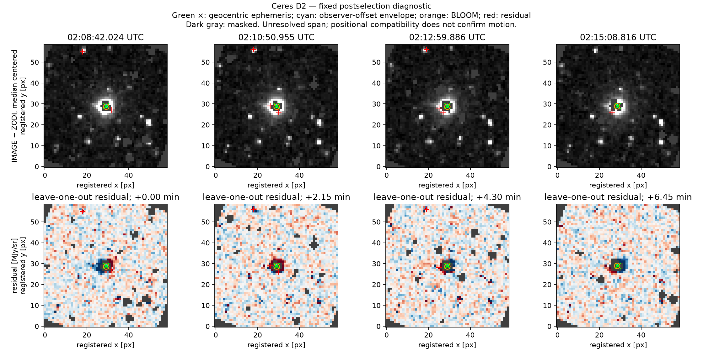

# Ceres D2: fixed postselection diagnostic

The frozen default CLI completed on all four preselected exposures. Of 5 published candidates, 0 residual and 1 flagged BLOOM tracks satisfy the existing 1.5-pixel positional window at all their observed epochs (at least three).

Best published residual rank: **none**. Best flagged BLOOM publication rank: **5**. BLOOM tracks remain unscored and are not learned K1/K3 retention or RF probabilities.

| Scorer on identical full residual pool | Best compatible residual rank | At K1 | At K3 |
|---|---:|---:|---:|
| v4 | none | False | False |
| c13 | none | False | False |
| heuristic | none | False | False |

The pool contains 4 measured residual proposals. Every published residual's coordinates, epoch order and V4 score matched the pre-label reproduction exactly; the first six feature columns are exact. C13 is its frozen scorer under the **same current preparation/proposals**, not the old end-to-end pipeline. Score scales are uncalibrated and are not compared as probabilities.

The 6.446533-minute geocentric span is **0.521574 pixel**, with an unapplied conservative observer-offset envelope up to **0.637460 pixel**. This is unresolved: position-compatible evidence does not confirm motion or object identity. Ephemerides use geocentric astrometric ICRF, not apparent-of-date positions; WCS/photocenter/ephemeris errors are additional. Ephemeris-center finite-pixel flags are `[False, False, False, False]` and do not filter this case out.

CLI wall time: 0.590s on the shared local interpreter; this is not a hard-cgroup resource proof. All 22 CLI PNG resources and the annotated figure passed decoding. Plot contrast uses fixed 1st/99th-percentile display scaling only; it changes no detection or matching decision.

Candidate graph: `c596f66fe073d669d7b1b8ae0bd5d5cf710910cf36f34ad04fc08bcd10ecdb35`. Metadata: `472a3db474a84d856110a7f52907c461c402ddde640fa108ec9a521a79ab5e13`. Result: `13ce38e92c9918adac442ca6cd5c5d55bdede94485dbf63db1c5c71b4c7e3bb3`. Prediction seal: `5fc40a492f08dbb976b7415392296edeb477ccfe9bff4b72fe290c6555bd9692`.

This crop was selected using known target metadata before pixels; it is not a blind sky search or survey-precision estimate. Other real tracks remain UNKNOWN. Source/model/default settings and case were unchanged; no fitting, new query, threshold relaxation or substitution occurred. Original four raw hashes and the entire immutable 403-file acquisition capsule remain unchanged. No twelve-FINAL pixels were accessed. This optional diagnostic adds no release criterion and permits no model reselection.
